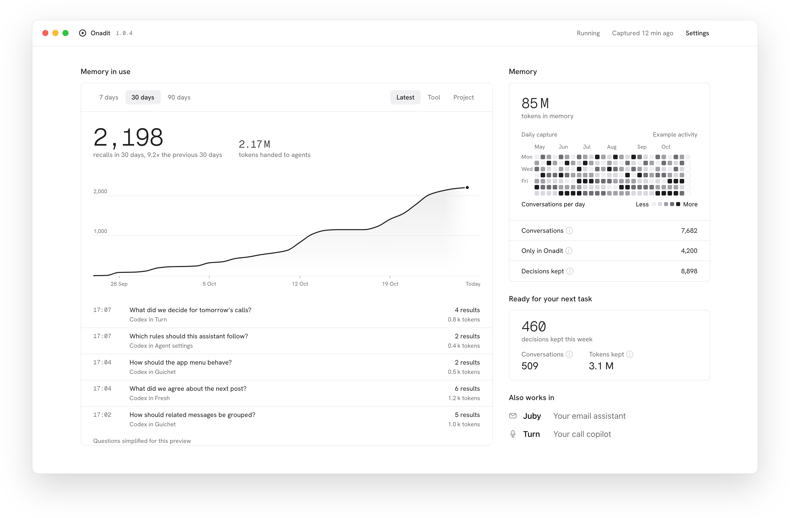

<h1 align="center">Onadit</h1>

  Smart, local memory for all your agents.

  <a href="https://onadit.com/download"><b>Download for Mac</b></a>
  &nbsp;·&nbsp;
  <a href="https://onadit.com/docs">Docs</a>
  &nbsp;·&nbsp;
  <a href="https://onadit.com">onadit.com</a>

  

  Onadit keeps your AI conversations on your Mac, 
  so the agents you connect can look up what you already worked out.

  For Apple Silicon Macs. Signed with a Developer ID certificate and notarized by Apple. 
  Each <a href="https://github.com/clementrog/onadit/releases">release</a> lists its SHA-256.

